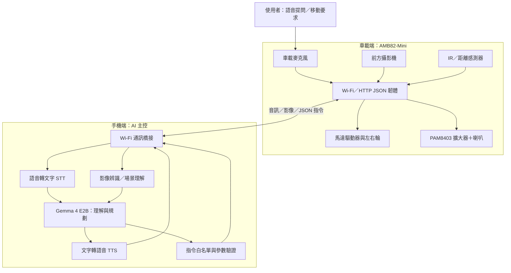

# PROPOSAL：Wi-Fi AI 智慧語音視覺車

- **專題名稱：** Wi-Fi AI 智慧語音視覺車（AI RoboCar）
- **硬體控制核心：** Realtek AMB82-Mini
- **手機端 AI：** Google AI Edge Gallery + Gemma 4 E2B
- **文件狀態：** 專題規劃與原型設計；實際功能須依硬體整合與測試結果更新

## 1. 專題摘要

本專題將一般兩輪差速小車改造成可透過自然語言互動的 AI 智慧車。使用者以車上的麥克風直接說話，車載 AMB82-Mini 收音後透過 Wi-Fi 將音訊傳送至手機；手機端執行語音辨識、Gemma 4 E2B 語意理解與行動規劃，再將結構化指令傳回車輛。車上的喇叭負責播放手機端產生的語音回覆。

影像方面，攝影機安裝於車體前方，AMB82-Mini 擷取影像並透過 Wi-Fi 傳回手機，由手機端 AI 進行物件辨識與場景理解。AMB82-Mini 不負責大型語言模型推論，而是專注於感測資料擷取、馬達控制、喇叭播放與安全保護。

**核心原則：手機負責理解與決策，車載硬體負責感知資料傳輸與安全地執行指令。**

## 2. 專題目標

1. 建立 AMB82-Mini 與手機之間的 Wi-Fi 通訊。
2. 讓使用者能直接對車上的麥克風說話，不必拿著手機對車輛下指令。
3. 由手機端完成語音轉文字、Gemma 4 E2B 指令理解及行動規劃。
4. 將攝影機畫面傳回手機，讓手機端 AI 回答「前方有什麼？」等視覺問題。
5. 透過車上喇叭播放語音回覆，形成完整的語音輸入與語音輸出。
6. 以白名單 JSON 指令控制車輛，並在韌體端保留避障、逾時停止與斷線停止等安全機制。

## 3. 功能範圍

### 3.1 第一階段必要功能（MVP）

| 功能 | 使用者體驗 | 負責端 |
|---|---|---|
| 車載語音收音 | 使用者直接對車子說話 | AMB82-Mini 麥克風 |
| 語音辨識 | 將語音轉成文字 | 手機端 STT |
| AI 指令理解 | 將「往前走一小段」轉成安全的動作參數 | 手機端 Gemma 4 E2B |
| 車輛移動 | 前進、後退、左轉、右轉、停止 | AMB82-Mini + 馬達驅動器 |
| 車載喇叭播放 | 播放 AI 語音回覆或提示音 | AMB82-Mini + PAM8403 + 喇叭 |
| 影像擷取與回傳 | 拍攝車前畫面並傳到手機 | AMB82-Mini 攝影機 + Wi-Fi |
| 影像理解 | 回答畫面中的物件或環境問題 | 手機端視覺模型／AI 流程 |
| 基本安全保護 | 障礙物、命令逾時或通訊中斷時停止 | AMB82-Mini + 距離感測器 |

### 3.2 暫不納入本次範圍

為了讓專題能在有限時間內完成，第一版不納入以下項目：

- 自主導航、地圖建構（SLAM）及複雜路徑規劃。
- 人臉辨識、人物追蹤與情緒辨識。
- 雲端帳號、遠端網際網路控制及長期對話資料庫。
- 多車協作、機械手臂、LED 表情系統及玩偶舵機。
- 讓語言模型直接輸出 GPIO、PWM 或任意馬達電壓。

上述功能可列為未來擴充，不列入本次驗收標準。

## 4. 系統架構



### 4.1 資料流程：語音控制

1. 使用者直接對車載麥克風說出需求。
2. AMB82-Mini 擷取音訊，透過 Wi-Fi 傳送到手機。
3. 手機端 STT 將音訊轉成文字。
4. Gemma 4 E2B 判斷使用者意圖，產生受限制的 JSON 動作指令。
5. 手機端先驗證指令名稱、速度與持續時間，再傳回 AMB82-Mini。
6. AMB82-Mini 檢查安全條件後控制馬達。
7. 手機端 TTS 產生語音回覆，音訊傳回車輛，由車載喇叭播放。

### 4.2 資料流程：影像辨識

1. 使用者提出視覺問題，或透過手機介面要求拍攝。
2. AMB82-Mini 擷取車前攝影機畫面。
3. 影像以 JPEG 等格式經 Wi-Fi 傳回手機。
4. 手機端視覺模型分析影像，必要時將辨識結果交由 Gemma 4 E2B 整理。
5. 手機端以文字及／或語音回覆使用者。

> 第一版採「需要時拍攝／回傳影像」的方式，不持續無限制傳送影像，以降低頻寬與耗電。

## 5. 硬體配置

| 項目 | 建議配置 | 用途／備註 |
|---|---|---|
| 主控板 | Realtek AMB82-Mini | Wi-Fi、攝影機／麥克風介面及車載控制 |
| 攝影機 | AMB82-Mini 板載攝影機 | 車前影像擷取；依實際板卡確認鏡頭視角與影像 API |
| 麥克風 | AMB82-Mini 板載麥克風 | 收錄使用者語音；需確認音訊擷取與串流格式 |
| 音訊擴大器 | PAM8403 | 放大 AMB82-Mini 的音訊輸出 |
| 喇叭 | 與 PAM8403 供電及阻抗規格相容的小型喇叭 | 播放 AI 語音及提示音 |
| 車體 | 兩輪差速底盤＋萬向輪 | 提供基本移動能力 |
| 馬達 | 直流減速馬達 × 2 | 左右輪獨立控制 |
| 馬達驅動器 | 與馬達額定電壓／堵轉電流相容的雙路 H-bridge 驅動板 | 控制前進、後退、轉向與停止 |
| 距離感測器 | IR 或其他相容距離感測器 | 近距離障礙物安全停止 |
| 電源 | 電池組、主電源開關及合適的穩壓模組 | 馬達與邏輯電源應依規格分配，避免馬達雜訊造成重啟 |
| 配線與固定件 | 杜邦線、端子、螺絲、支架 | 原型組裝與線材固定 |

**硬體選型注意：** 馬達驅動器、電池電壓、穩壓器電流及喇叭阻抗需依實際零件規格確認。AMB82-Mini 的腳位、PWM、音訊輸入輸出及攝影機 API 也必須依所使用的 Arduino core／SDK 版本核對，不在本提案中臆測固定腳位。

## 6. 軟體與通訊設計

### 6.1 手機端

- **AI 模型：** Gemma 4 E2B（依 Google AI Edge Gallery 實際支援版本與裝置效能確認）。
- **語音辨識（STT）：** 將車載麥克風傳來的音訊轉為文字。
- **影像辨識：** 接收車載攝影機影像並分析物件／場景。
- **AI Agent：** 將自然語言轉為有限且明確的車輛工具呼叫。
- **語音合成（TTS）：** 將回覆轉成音訊傳回車載喇叭。
- **通訊橋接：** 透過 HTTP／WebSocket 與車載端交換資料。若 Edge AI Gallery 的 Skill／MCP 執行環境無法直接存取區域網路，需增加手機端本機橋接服務或簡易控制 App。

### 6.2 車載端

AMB82-Mini 韌體只公開有限的語意操作，不允許 AI 任意指定 GPIO 或 PWM：

| API／動作 | 用途 |
|---|---|
| `GET /status` | 回報 Wi-Fi、電池／感測器及車輛狀態（可取得的欄位） |
| `POST /drive` | 執行前進、後退、左轉、右轉等白名單動作 |
| `POST /stop` | 立即停止馬達 |
| `GET /camera/frame` | 擷取並回傳單張影像 |
| `POST /audio/upload` | 接收手機端合成的語音音訊 |
| `POST /audio/play` | 播放已接收或預載的音訊 |
| `POST /audio/record` | 開始／停止收音或音訊上傳（依韌體實作） |

### 6.3 JSON 指令範例

```json
{
  "action": "drive",
  "direction": "forward",
  "speed": 35,
  "duration_ms": 800,
  "request_id": "demo-001"
}
```

韌體必須自行限制速度、時間及可用方向；收到未知欄位或超出範圍的值時拒絕執行。停止指令應具有最高優先權。

## 7. 安全、可靠性與隱私

1. **斷線保護：** 車輛若在設定時間內未收到有效控制更新，韌體自動停止馬達。
2. **避障優先：** 距離感測器觸發安全門檻時，韌體直接停止，不等待手機 AI 回應。
3. **命令限制：** 只接受白名單動作；限制速度、轉向幅度及單次動作時間。
4. **急停：** 提供實體電源開關，並保留可由手機觸發的停止命令。
5. **電源安全：** 馬達電源與邏輯電源妥善分配，確認電池保護、穩壓與電流能力。
6. **隱私：** 預設不長期儲存音訊與影像；需要除錯紀錄時先取得同意並限制保存內容。
7. **測試環境：** 初期只在平坦、空曠、低速且有人看顧的環境測試。

## 8. 開發時程與里程碑

| 階段 | 工作內容 | 驗收條件 |
|---|---|---|
| 1. 硬體點亮 | AMB82-Mini、Wi-Fi、馬達與電源測試 | 可連線、可安全停止 |
| 2. 車輛控制 | 建立 `/status`、`/drive`、`/stop` | 手機可控制四方向及停止 |
| 3. 車載音訊 | 麥克風收音、音訊上傳、喇叭播放 | 可完成一次語音錄製與播放 |
| 4. 手機 AI | STT、Gemma 4 E2B、JSON 指令驗證 | 語音需求可轉成有效車輛指令 |
| 5. 影像回傳 | 擷取 JPEG 並傳回手機 | 手機可顯示車前影像 |
| 6. 影像理解 | 手機端辨識物件並生成回答 | 能回答至少數種測試場景問題 |
| 7. 整合與安全 | 斷線、避障、逾時與錯誤命令測試 | 所有安全測試均能停止車輛 |

## 9. 創意與專題特色

- **手機作為 AI 大腦、車輛作為實體載具：** 避免把大型模型塞進微控制器，將運算與即時控制分工。
- **雙向語音互動：** 不只是手機遙控車輛，而是能直接對車說話、由車上的喇叭回應。
- **視覺問答：** 使用者可詢問車前環境，手機端 AI 根據車載相機畫面回答。
- **安全優先的 Agent：** AI 只能選擇有限的語意動作，最後仍由韌體執行安全檢查。

## 10. 預期成果

1. 一台可透過 Wi-Fi 與手機溝通的兩輪智慧車。
2. 一套手機端 AI 流程，可完成語音辨識、Gemma 4 E2B 指令理解及 TTS。
3. 車載攝影機影像回傳與手機端影像辨識展示。
4. 可供展示的 HTTP／JSON API、韌體程式與系統架構文件。
5. 一份包含功能測試與安全測試結果的專題紀錄。

## 11. 風險與待確認事項

- Gemma 4 E2B、STT、視覺模型與 TTS 是否能在目標手機上同時順暢運作，需實測。
- Google AI Edge Gallery 的 Skill／MCP 與區域網路 HTTP 橋接能力，需依實際 App 版本確認；必要時開發輕量手機橋接程式。
- AMB82-Mini 板載麥克風／攝影機的資料擷取、音訊格式與網路傳輸方式，需以實際 SDK 驗證。
- PAM8403 的輸入訊號、供電與喇叭阻抗需依模組規格接線。
- 馬達電流可能造成電壓下降或影響影像／音訊模組，需量測並改善供電與濾波。

---

**本提案的第一優先是完成「車載收音 → 手機 AI 理解 → 車輛動作／喇叭回覆」與「車載拍攝 → 手機影像辨識」兩條端到端流程；其他功能不列入第一版。**
