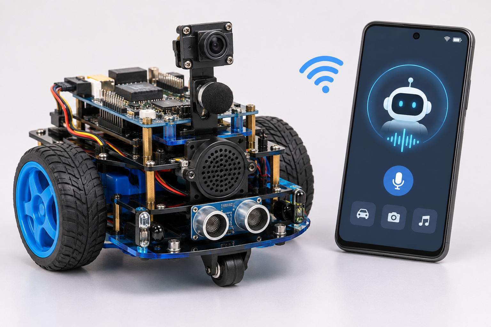
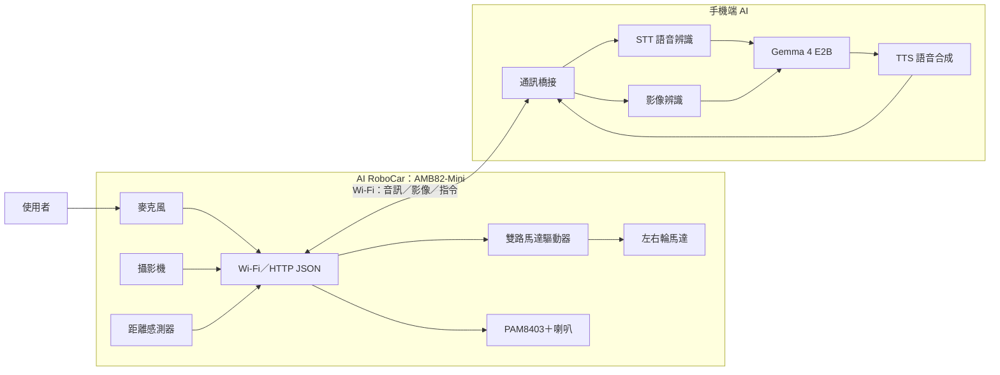

# AI RoboCar｜Wi-Fi AI 智慧語音視覺車

> **手機負責 AI 理解與決策，AMB82-Mini 負責車載感測、通訊與動作執行。**

本專題以 Realtek AMB82-Mini 為車載控制核心，搭配手機端 Google AI Edge Gallery／Gemma 4 E2B，製作一台能聽懂語音指令、透過喇叭回話，並將前方攝影機畫面傳回手機進行 AI 影像辨識的智慧車。

## 成品概念圖



<sub>上圖為 AI 合成之專題外觀概念圖，用於呈現預計整合的車體、攝影機、麥克風、喇叭與手機 AI 操作介面；並非已完成實體成品照片。</sub>

## 1. 專題功能

| 功能 | 說明 |
|---|---|
| 車載語音輸入 | 使用者直接對車上的麥克風說話 |
| 手機端語音辨識 | 手機將車載音訊轉成文字 |
| AI 自然語言理解 | Gemma 4 E2B 將需求轉成有限的車輛控制指令 |
| 車輛移動 | 控制兩輪車前進、後退、左轉、右轉與停止 |
| 車載喇叭 | 播放手機端 TTS 語音回覆或提示音 |
| 車載影像擷取 | 前方攝影機拍攝畫面並透過 Wi-Fi 傳回手機 |
| 手機端影像辨識 | 分析車前物件與場景，支援簡單視覺問答 |
| 安全保護 | 韌體端處理避障、控制逾時與 Wi-Fi 斷線停止 |

## 2. 系統架構



### 運作流程 A：直接對車輛說話

1. 使用者對車載麥克風說「向前走一小段」。
2. AMB82-Mini 將音訊透過 Wi-Fi 傳給手機。
3. 手機端 STT 轉成文字，Gemma 4 E2B 解析意圖。
4. 手機將通過驗證的 JSON 指令傳回車輛。
5. AMB82-Mini 檢查安全條件並控制左右輪。
6. 手機端 TTS 產生回覆音訊，車上喇叭播放。

### 運作流程 B：車前影像辨識

1. 使用者要求「幫我看看前面有什麼」。
2. AMB82-Mini 擷取攝影機畫面。
3. 畫面經 Wi-Fi 傳到手機。
4. 手機端視覺模型辨識物件或場景，再由 Gemma 整理回答。
5. 回答可顯示於手機，亦可透過車載喇叭播放。

## 3. 硬體配置

| 硬體 | 數量 | 用途 |
|---|---:|---|
| Realtek AMB82-Mini | 1 | 主控、Wi-Fi、攝影機／麥克風資料擷取 |
| 板載攝影機 | 1 | 車前影像 |
| 板載麥克風 | 1 | 語音輸入 |
| PAM8403 擴大器模組 | 1 | 喇叭音訊放大 |
| 相容小型喇叭 | 1 | 語音回覆 |
| 兩輪差速車體 | 1 組 | 車體底盤 |
| 直流減速馬達 | 2 | 左右輪驅動 |
| 雙路 H-bridge 馬達驅動板 | 1 | 控制馬達方向與速度 |
| IR／距離感測器 | 1 組 | 近距離障礙物偵測 |
| 電池、穩壓模組、開關 | 1 組 | 車體供電 |
| 配線、固定件 | 依需求 | 電路連接與機構固定 |

> 馬達驅動器與電池規格需依馬達額定電壓及堵轉電流選擇；AMB82-Mini 腳位與周邊 API 請依實際板卡版本核對。此表為規劃 BOM，並非已完成採購清單。

## 4. 軟體配置

| 層級 | 技術／工具 | 工作 |
|---|---|---|
| 車載韌體 | Arduino IDE／AMB82-Mini SDK（依板卡支援版本） | Wi-Fi、感測、馬達控制、音訊播放 |
| 手機 AI | Google AI Edge Gallery | 手機端模型與 Agent 操作環境 |
| 語言模型 | Gemma 4 E2B | 自然語言理解與動作規劃 |
| 語音辨識 | 手機端 STT | 車載音訊轉文字 |
| 影像辨識 | 手機端視覺模型 | 分析車載攝影機畫面 |
| 語音合成 | 手機端 TTS | 產生回覆音訊 |
| 通訊 | Wi-Fi、HTTP／JSON；需要時採 WebSocket | 車載端與手機端資料交換 |

**注意：** 手機端模型、STT、影像辨識、TTS 與區域網路橋接的實際整合方式，需依手機效能及 Google AI Edge Gallery 版本驗證。若 App 的 Skill／MCP 環境無法直接呼叫區域網路 API，需額外建立手機端橋接服務。

## 5. 車載 API 規劃

| API | 方法 | 功能 |
|---|---|---|
| `/status` | GET | 查詢車輛狀態 |
| `/drive` | POST | 執行白名單移動命令 |
| `/stop` | POST | 立即停止 |
| `/camera/frame` | GET | 擷取車前影像 |
| `/audio/upload` | POST | 接收手機端 TTS 音訊 |
| `/audio/play` | POST | 播放音訊 |
| `/audio/record` | POST | 控制收音／音訊傳輸 |

JSON 指令示例：

```json
{
  "action": "drive",
  "direction": "forward",
  "speed": 35,
  "duration_ms": 800
}
```

韌體必須驗證動作、速度與時間範圍，不可直接接受任意 GPIO 或 PWM 數值。

## 6. 安全設計

- Wi-Fi 斷線或控制逾時時，韌體自動停止馬達。
- 距離感測器偵測到近距離障礙物時，韌體優先停止。
- 所有動作均有速度與持續時間上限。
- 保留實體電源開關；測試時由人員看顧。
- 預設不長期保存音訊及影像。

## 7. 開發進度規劃

- [ ] AMB82-Mini Wi-Fi 連線與 `/status`
- [ ] 左右輪馬達控制與 `/stop`
- [ ] 手機端送出 JSON 控制指令
- [ ] 車載麥克風收音並傳至手機
- [ ] 手機 STT + Gemma 4 E2B 指令理解
- [ ] 手機 TTS 音訊傳回車載喇叭
- [ ] 車載攝影機擷取與 Wi-Fi 影像回傳
- [ ] 手機端影像辨識與問答
- [ ] 斷線、逾時、避障安全測試

## 8. 專案資料夾

```text
AI-plush-giraffe/
├── PROPOSAL.md                 # 專題提案、功能範圍與實作規劃
├── README.md                   # 專案介紹與系統架構
├── Architecture.md             # 原始架構參考文件（後續需同步更新）
├── GiraffeAgent.ino            # 原始玩偶 Agent 韌體參考，需改寫為車輛控制
├── SKILL.md                    # 原始 Agent Skill 參考，需調整工具名稱
├── scripts/
│   └── index.html              # 原始 Skill／API 橋接參考
└── assets/
    └── ai-robocar-concept.png  # AI 合成車體概念圖
```

> Repository 目前仍保留 `AI-plush-giraffe` 名稱及部分 Giraffe 玩偶範例程式。此 README 描述的是本專題選定的 RoboCar 方向；原始玩偶的舵機、表情 LED 等功能不屬於本次 MVP，相關韌體與 Skill 尚須配合車體重新實作。

## 9. 參考資料

- [原始 GitHub Repository](https://github.com/rkuo2000/AI-plush-giraffe)
- [Architecture.md](https://github.com/rkuo2000/AI-plush-giraffe/blob/main/Architecture.md)
- [Gemma 模型與 Google AI Edge Gallery](https://github.com/google-ai-edge/gallery)

## 10. 專題定位

本專題展示 Edge AI Agent 與嵌入式控制器的協作：手機端負責理解語音、分析影像及規劃行動；AMB82-Mini 負責將數位決策轉化為實際的移動、收音與聲音播放。第一版以兩條完整流程為目標：**車載語音輸入到車輛動作／語音回覆，以及車載影像回傳到手機端 AI 辨識。**
